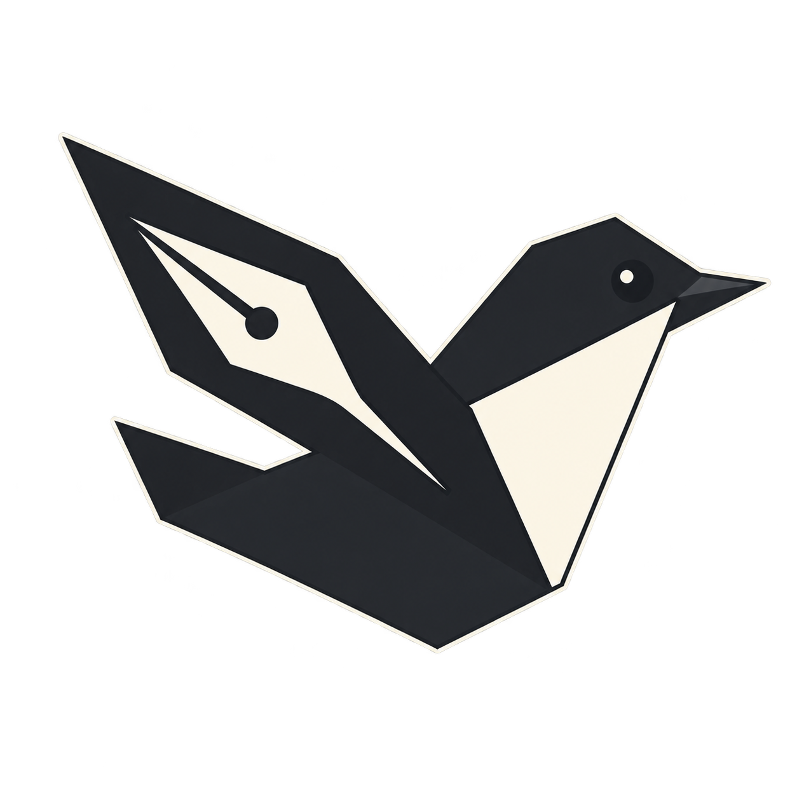
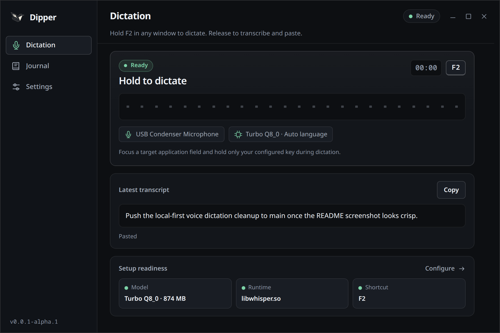

  

<h1 align="center">Dipper</h1>

  A personal, local-first voice dictation tool for Linux desktop.

  
  
  

  

## What it does

Hold a key, speak, and release. Dipper records audio locally, transcribes it with [whisper.cpp](https://github.com/ggml-org/whisper.cpp) on Vulkan, and pastes the result into the window you were focused on.

- **Local-first & private**: Speech recognition runs on your machine. Recordings and transcripts stay in a local Journal with no cloud dependency.
- **Push-to-talk**: Configured via KDE Global Shortcuts; focus-loss and cancellation suppress pasting.
- **Multilingual**: Automatic language detection without translation (built around German + English technical speech).
- **Tray-resident**: Runs quietly in the system tray alongside a compact desktop UI for status, Journal history, and settings.

## About this project

Dipper is a small, single-purpose tool I built and maintain for my own daily use on Fedora KDE. The entire codebase is AI-generated.

It is open source in case anyone wants to build something similar, borrow ideas, or fork it—take whatever is useful to you.

## Documentation

- [Development guide](docs/development.md) — native dependencies, build/run commands, and local setup
- [Desktop installation](docs/desktop-delivery.md) — Fedora packaging, installation, and rollback
- [App design](docs/app-design.md) — architecture, module boundaries, and insertion contract ([cross-app insertion](docs/cross-app-insertion.md))
- [Product & Journal](docs/product.md) — workflow, priorities, and [Journal requirements](docs/journal.md)
- [Benchmarks & research](benchmark/README.md) — model evaluations and research notes in [`docs/`](docs/)
- [Glossary](GLOSSARY.md) — shared domain terminology

## License

Released into the public domain under [The Unlicense](LICENSE). Do whatever you want with it.
